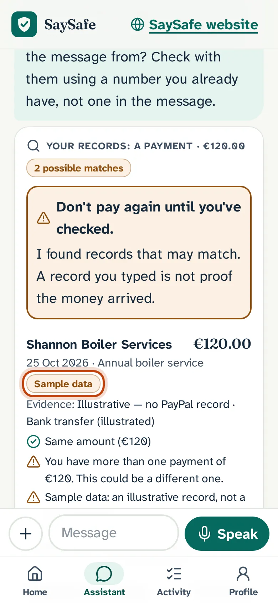
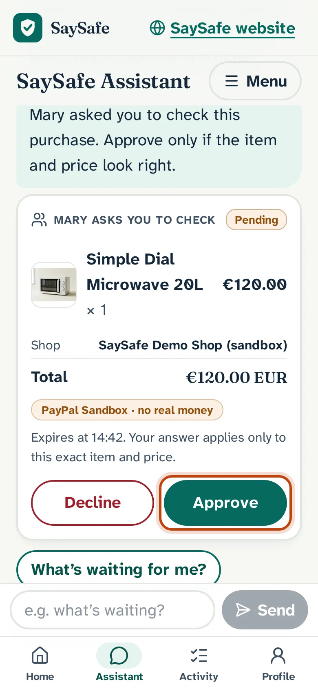
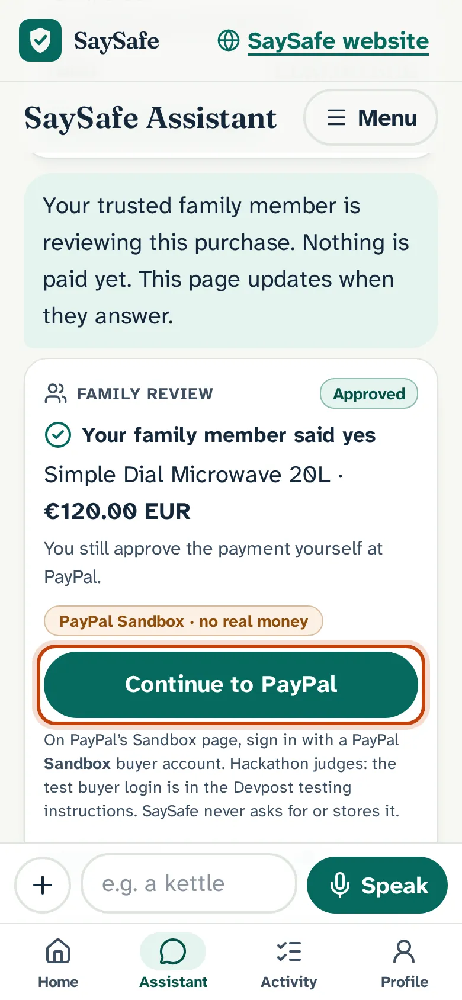
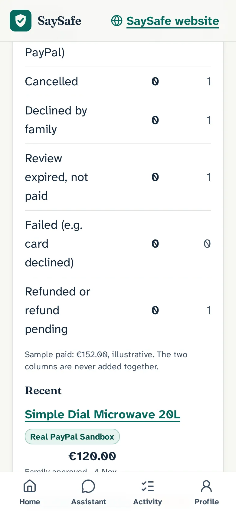
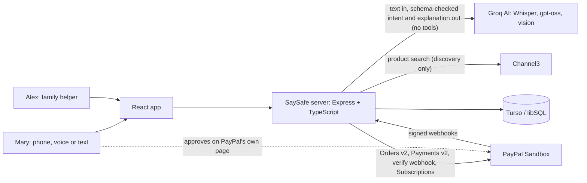

# SaySafe

**SaySafe helps people understand payment requests, avoid accidental repeat payments, get trusted assistance and verify payments.**
An AI payment safety companion for older adults and the family who help them.

**Live demo:** https://saysafe.onrender.com · **Learn SaySafe (14 guides):** [/learn](https://saysafe.onrender.com/learn) · **Judges’ Guide:** [/judges](https://saysafe.onrender.com/judges) · **Features:** [/features](https://saysafe.onrender.com/features) · **Test evidence:** [docs/TEST-EVIDENCE.md](docs/TEST-EVIDENCE.md)

> All payments use the **PayPal Sandbox**: test money, nothing is delivered. Built for the [PayPal AI Hackathon 2026](https://paypalaihackathon.devpost.com/). SaySafe is an independent project, **not affiliated with or endorsed by PayPal**.

## The flagship: Mary → Alex → PayPal Sandbox → verified receipt

1. **Mary asks first.** “I received a message saying I owe €120. Can you check whether I already paid?” SaySafe searches her own records and shows possible matches, labelled **Sample data**, and says a matching amount is not proof.
2. **She picks something to buy.** Real products from Channel3 open the retailer’s own site; the **SaySafe Demo Shop** microwave (€120.00 EUR, price fixed by the server) is the one SaySafe can protect.
3. **Alex approves.** It is over Mary’s €75 limit, so Alex, her family helper, sees that exact item, shop, price and expiry and taps **Approve**. The approval is bound to that purchase only.
4. **Mary approves at PayPal herself** on PayPal’s own sandbox page. Alex can never pay for her; the AI can never approve or pay.
5. **Verified receipt.** SaySafe re-reads the order, captures once, checks the capture with Payments v2, and shows **Captured**, then **Webhook verified** once PayPal’s signed notice passes verification. Asking “Did my payment go through?” again shows the same receipt.
6. **Activity and Insights** list it as a **Real PayPal Sandbox transaction**, never added to sample data.

Completed end to end on the hosted app with a real sandbox buyer on 3 Nov 2026 (captures `96T3543906935310P`, `19D86010XS597545K`, `0E885908SW635761P`; see [docs/TEST-EVIDENCE.md](docs/TEST-EVIDENCE.md)).

## For judges

- Follow **[/judges](https://saysafe.onrender.com/judges)**: 13 steps, exact prompts, about 5 minutes.
- The PayPal Sandbox **buyer login is provided only in the Devpost testing instructions**. It is never in this repository or the app. Without it you can do everything up to PayPal’s page.
- Render Free sleeps when idle: the first load can take about 60 seconds.
- Demo route for Alex: on Mary’s pending card choose **Try as Alex too** (same button in Profile › Demo & help); come back with Profile › **Back to Mary**.

## Key features

| Before payment | During payment | After payment |
|---|---|---|
| Scam Guardian (text, links, numbers, screenshots; never says “safe”) · trusted-contact mismatch (“Hi Mum, new number”) · “Have I already paid?” with possible-duplicate warnings · Channel3 product discovery · Demo Shop with server prices | Family approval over the limit, bound to the exact basket, single use, 30 min · buyer approval on PayPal’s page · Send-money hand-off to PayPal’s own page · tap-to-talk voice | Receipt from PayPal’s capture + Payments v2 check + signed webhook · safe status check and recovery (one capture) · Activity search · Insights for Mary and Alex · subscriptions with cancel guidance |

Every feature with its problem, example, data and limits: **[/features](https://saysafe.onrender.com/features)**.

| Mary asks | Alex approves | Continue to PayPal | Insights |
|---|---|---|---|
|  |  |  |  |

Screenshots are real captures of the hosted app (https://saysafe.onrender.com), taken with `scripts/shots-docs.mjs` on 4 November 2026; `web/public/docs-assets/manifest.json` records the source of every image (all `hosted`). Receipt screens need a completed sandbox payment, so they are described in text rather than shown; no mock images are used.

## Quick start

```bash
cp .env.example .env      # PAYPAL_CLIENT_ID, PAYPAL_CLIENT_SECRET (sandbox), GROQ_API_KEY, optional CHANNEL3_API_KEY
npm install
npm run dev               # web :5173, API :8787 (local SQLite)
npm test                  # vitest (PayPal, AI and Channel3 mocked)
npm run typecheck && npm run build
```

Deterministic local stack (mock PayPal :9999, recorded Channel3 :9998, no AI key): `npm run build && PORT=8792 scripts/local-stack.sh`.
Docs tooling: `node scripts/shots-docs.mjs <baseUrl>` (screenshots), `node scripts/docs-qa.mjs <baseUrl>` (links, axe, keyboard, dialog), `npx tsx scripts/docs-walkthrough.mjs <localUrl>` (follows the Judges’ Guide), `node scripts/record-demo.mjs <baseUrl>` (the demo video). Free keys: [PayPal Developer](https://developer.paypal.com/dashboard/), [Groq](https://console.groq.com/keys), [Channel3](https://trychannel3.com/). Deploy: `render.yaml`.

## Architecture



**AI interprets → server rules decide → the payer approves at PayPal → the server verifies.** Details: [docs/ARCHITECTURE.md](docs/ARCHITECTURE.md), [docs/PAYMENT-LIFECYCLE.md](docs/PAYMENT-LIFECYCLE.md).

## PayPal APIs used (sandbox)

| API | Used for |
|---|---|
| OAuth 2.0 client credentials | Server token, cached; a 401 clears it and retries once |
| Orders v2: create, get, capture | Checkout, re-reading the order before capture, idempotent capture (`PayPal-Request-Id`) |
| Payments v2: get capture, refund | Capture check on the timeline; merchant refunds (admin only, off on the hosted demo) |
| Webhooks: verify signature | `PAYMENT.CAPTURE.*` verified, deduplicated and stored |
| Subscriptions | The Demo Membership (sandbox). Cancel is proven by API script; not yet verified through the app |

SaySafe’s PayPal connection is a merchant account: it can’t read a buyer’s PayPal account or wallet, and it can’t send money to a person (Send money opens PayPal’s own page). The Agent Toolkit/MCP is deliberately not used: the model gets no PayPal tools. The integration was checked against APIMatic’s PayPal Context Plugin guidance ([docs/APIMATIC-AUDIT.md](docs/APIMATIC-AUDIT.md)).

## AI and Channel3

- **Groq** (`server/ai/provider.ts`): `openai/gpt-oss-20b` (intents, scam explanations, Insights answers), `openai/gpt-oss-120b` (beta reply languages), `qwen/qwen3.8-27b` (screenshots), `whisper-large-v3-turbo` (speech). Models return schema-validated text and intents only: no tools, no database or PayPal access. The AI can make a scam warning stronger with a quoted reason, never weaker, and never says “safe”.
- **What is sent to the AI:** messages, screenshots and voice clips you submit; for Insights questions, a summary of the records the asker is allowed to see (for Alex, only permission-filtered records). Saved contacts and typed payment records are never sent.
- **Fallback provider:** the server can be configured with an OpenAI-compatible fallback (e.g. Gemini via `AI_FALLBACK_*`). Whether the hosted demo sets it is checked on Render at deploy time; if it is set, Gemini also processes the requests above.
- **Channel3:** real products, prices, images and retailer links. Discovery only: those purchases happen on the retailer’s site.
- **Insights:** the public site uses SaySafe’s own **native React dashboard**. An optional AG Studio view exists for evaluation only and is **not enabled** publicly ([docs/AG-STUDIO.md](docs/AG-STUDIO.md)).

## Memory: what's on and off by default

| Feature | Default | Why | Where it's explained |
|---|---|---|---|
| Long-term memory (“What SaySafe remembers”: shopping preferences Mary clearly states) | **On** | Saves repeating “black, under €150” every time. Disclosed by a one-time notice in the Assistant; Mary can see, change, remove, clear or turn it off, and off stops saving at once. The demo starts with two labelled **Sample** preferences. | Assistant notice · Profile › What SaySafe remembers · Help › Privacy and data · [docs/MEMORY.md](docs/MEMORY.md) |
| Recent conversation (last 10 messages + 20 products shown, 14 days) | On, even with memory off | Only so “that one” / “the cheaper one” works after a reload; never proof of payment. “Clear conversation” deletes it. | Profile › What SaySafe remembers · Help › Privacy and data |
| Family sharing: spending summaries / purchase history | **Off** | Alex sees only purchases above Mary’s limit unless she chooses to share more. | Profile › Family sharing · Help › What Alex can see |
| Spoken replies (voice) | **Off** | Never plays sound without consent. | Assistant · Profile › Voice & conversation |

Alex can never see memory or conversation context, and memory never pays or approves anything. Earlier messages are not shown again in a new tab (the context is used, not displayed).

## Security boundaries

Server-side prices; family approval bound to the exact basket, single use, 30-minute expiry; Mary can’t approve her own request; payer approval at PayPal; one capture in flight; durable idempotency; verified, deduplicated webhooks; sample data never actionable; per-visitor household isolation; never opens links in messages.

**Family permissions** (enforced on the server): Alex sees and answers only the requests above Mary’s limit (item, shop, amount, status, and later whether it was paid). Purchases under the limit stay private. Two optional switches, both off by default and revocable: “Share spending summaries with Alex” (totals only) and “Share my purchase history with Alex”. Only Mary changes her limit. Alex never sees her conversations, other payments, contacts or subscriptions. Details: [docs/SECURITY-BOUNDARIES.md](docs/SECURITY-BOUNDARIES.md).

## Tests and evidence

| Kind | What |
|---|---|
| **Mocked** (Node, PayPal/AI/Channel3 test doubles) | vitest + `tsc` + build on every push (GitHub Actions). Covers the state machine, approval binding, capture idempotency and capture timeouts, webhook paths, isolation, labels, the docs wording rules |
| **Local browser** (Playwright Chromium, mock PayPal, recorded Channel3) | `e2e-flagship.mjs`, `visual-regression.mjs`, `docs-qa.mjs`, `docs-walkthrough.mjs`. axe results apply to the pages and emulated viewports those scripts visit |
| **Hosted + real PayPal Sandbox** | Flagship runs with a real sandbox buyer: one capture each, signed webhook verified, no double charge on reload. Lost redirects, duplicate confirms and webhook resends were checked live; capture timeouts only in mocked tests |

Counts, dates and commits: [docs/TEST-EVIDENCE.md](docs/TEST-EVIDENCE.md).

## Security & limitations

- **PayPal Sandbox only.** Every payment uses fake test money; nothing real is bought, charged or delivered.
- **No real PayPal accounts.** Only PayPal Sandbox test accounts work. Never enter a real PayPal login.
- **The AI never pays and never approves.** It suggests; the person approves at PayPal themselves, and purchases over the family limit need the family member's approval first. The amount always comes from the server catalogue, never from the AI.
- **English only is verified.** Other reply languages are beta and unverified.
- **Voice tested in Chromium only** (headless, simulated microphone); voice on iPhone Safari is not verified, and real phones are untested. Spoken replies are **off until the person turns them on** (consent); the microphone works either way.
- **Scam detection is not independently verified.** Held-out set of 42 messages: 2 false alarms, 1 missed scam. Nothing about the sender is verified, and links are never opened.
- **Sample data is fictional from this release** (made-up company names, drama-range phone numbers, example.com emails) and labelled "Sample data". Channel3 listings are real products from real retailers, bought on the retailer's own site.
- **Free hosting:** the hosted demo sleeps when idle; the first visit can take about **60 seconds** to wake up.
- **Judges' PayPal Sandbox buyer login is shared only via Devpost**, never in the app or this repository.

**Also:** no physical-phone, screen-reader or older-adult testing yet, and SaySafe doesn’t claim to have prevented any fraud. Payment memory covers only SaySafe and what you type (no bank or wallet import). Demo Membership cancel is proven by API script, not yet through the app. Refunds are admin-only and off on the hosted demo.

**Roadmap:** real-phone and real-person testing; verified languages; reminders before charges; read-only MCP server (future): let other assistants ask SaySafe “have I paid this?” or “is this message a scam?” with household-scoped OAuth, audit log and no money actions. Not built.

## More documentation

[ARCHITECTURE](docs/ARCHITECTURE.md) · [PAYMENT-LIFECYCLE](docs/PAYMENT-LIFECYCLE.md) · [SECURITY-BOUNDARIES](docs/SECURITY-BOUNDARIES.md) · [TEST-EVIDENCE](docs/TEST-EVIDENCE.md) · [MANUAL-ACCEPTANCE](docs/MANUAL-ACCEPTANCE.md) · [PRODUCT-OVERVIEW](docs/PRODUCT-OVERVIEW.md) · [DEMO-DATA](docs/DEMO-DATA.md) · [SCAM-DETECTION](docs/SCAM-DETECTION.md) · [VOICE](docs/VOICE.md) · [DATABASE](docs/DATABASE.md) · [UI-QUALITY](docs/UI-QUALITY.md) · [DOCS-SITE](docs/DOCS-SITE.md) · [MEMORY](docs/MEMORY.md)

## Licence

[MIT](LICENSE) © 2026 Laxman Prasad Somaraju. Third parties: PayPal Sandbox APIs, Groq, Channel3, Render, Turso, APIMatic Context Plugins, React, Vite, Tailwind CSS, Express, libSQL, zod, lucide, Playwright, axe-core, Atkinson Hyperlegible and Fraunces. Fraud figures on the landing page: FTC, FBI IC3, Central Bank of Ireland, UK Finance, National Anti-Scam Centre, Canadian Anti-Fraud Centre. None of these organisations endorse SaySafe.
