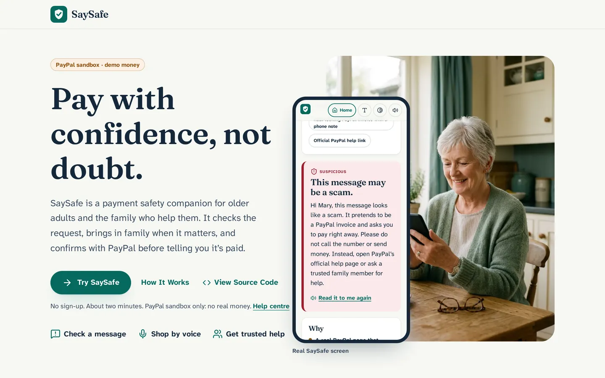
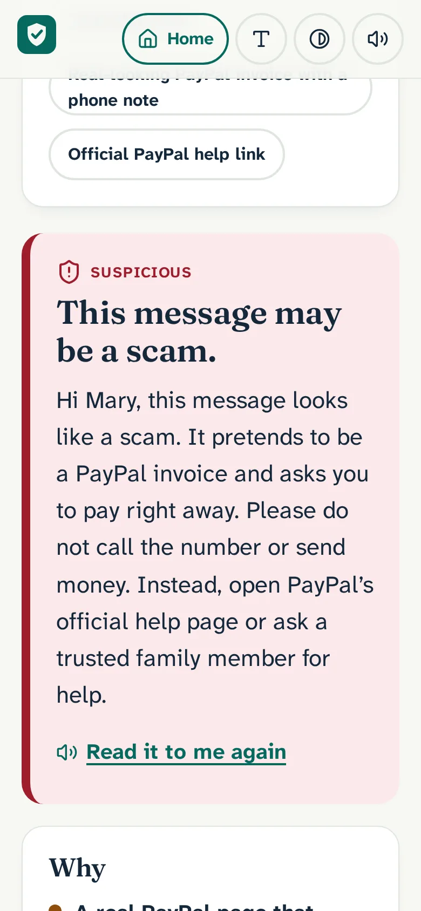
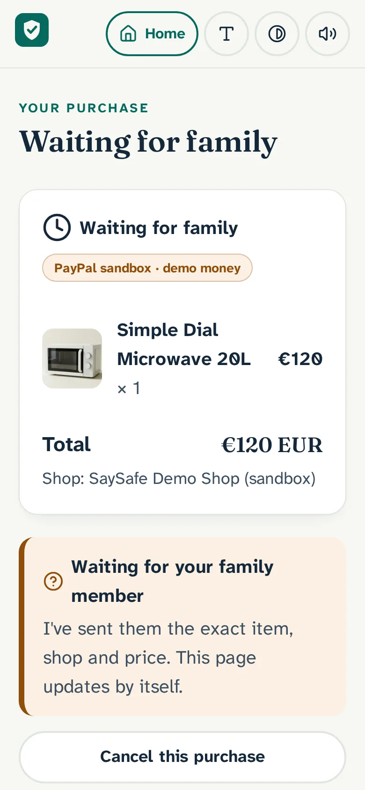
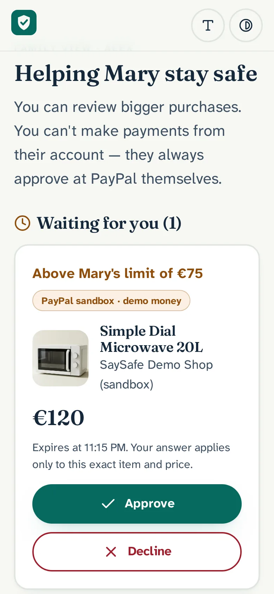
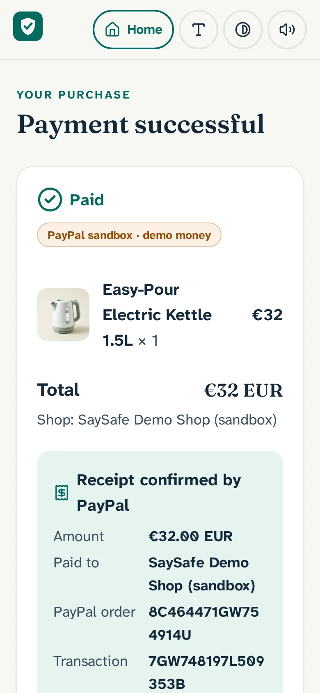
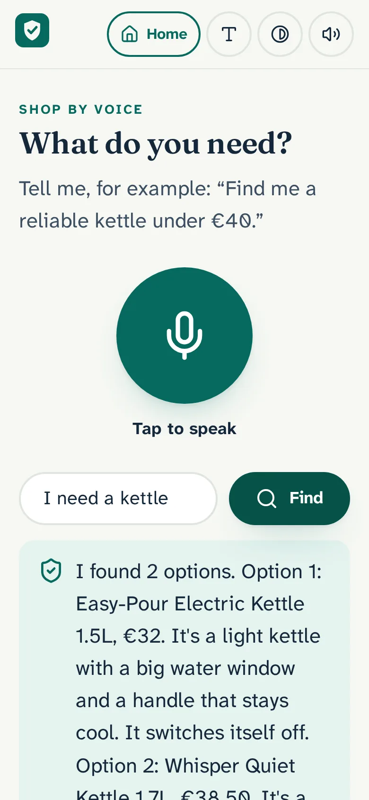

# SaySafe

**Pay with confidence, not doubt.** An AI payment safety companion for older adults and the family who help them.

**Live demo:** https://saysafe.onrender.com · **Help centre:** https://saysafe.onrender.com/help · **Product status:** [docs/PRODUCT-OVERVIEW.md](docs/PRODUCT-OVERVIEW.md) · **Test evidence:** [docs/TEST-EVIDENCE.md](docs/TEST-EVIDENCE.md)

> All payments use the **PayPal sandbox**. No real money moves. Built for the [PayPal AI Hackathon 2026](https://paypalaihackathon.devpost.com/). SaySafe is an independent project and is **not affiliated with or endorsed by PayPal**.

---

## 2. Problem

Payment scams increasingly look genuine. A real PayPal invoice can carry a scammer's phone number in its note, and a link to paypal.com proves nothing about the request. Older adults lose large sums this way: about **US$3 billion** in fraud losses were reported to the FTC by people aged 60+ in 2025 ([FTC](https://www.ftc.gov/news-events/news/press-releases/2026/10/ftc-issues-annual-report-congress-agencys-actions-protect-older-adults)), and **€179 million** in fraudulent payments were reported in Ireland in 2025, all ages ([Central Bank of Ireland](https://www.centralbank.ie/news/article/press-release-payment-fraud-increases-by-27-to-reach-179-million-in-2025-central-bank-of-ireland-report-finds)). Online shopping itself is also hard work for many people, and after paying they are often unsure whether it went through.

## 3. Who it is for

- Older adults who want a second look before they pay.
- The son, daughter or friend they would ring for advice, who can review bigger purchases without ever being able to pay for them.

## 4. Features

Organised as **Before → During → After payment**. Every feature and its exact status (Implemented and hosted / awaiting live verification / In development / Planned / Not supported) is in [docs/PRODUCT-OVERVIEW.md](docs/PRODUCT-OVERVIEW.md).

| Stage | Features |
|---|---|
| Before | Scam Guardian (text, links, emails, phone numbers, screenshots), safe next steps and official PayPal links, SaySafe Assistant (text and tap-to-talk voice), Channel3 real-product discovery and comparison, share a check with family |
| During | SaySafe Demo Shop, exact purchase review, family spending threshold, family approve/decline with expiry, buyer approval on PayPal's sandbox page, verified single capture, lost-redirect recovery |
| After | Receipt confirmed from PayPal's capture, payment timeline with signed-webhook evidence, searchable Activity, refund request (buyer) and merchant refund (admin-only, off on the hosted demo), order-problem guidance, Family Safety Insights |

**Now in the hosted demo:** interactive Assistant cards (purchase review, family status, receipt and refund cards inside the conversation). **In development:** a regrouped Activity screen.

## 5. Screenshots

Real captures (PayPal sandbox, fictional data; ids and emails redacted). New captures of the hosted app live in [`docs/screenshots/`](docs/screenshots/); the in-app set below is from earlier builds and is being retaken with seeded demo data.

| Hosted landing (desktop) |
|---|
|  |

| Scam check result | Waiting for family | Family member approves | PayPal-confirmed receipt | Shopping by voice |
|---|---|---|---|---|
|  |  |  |  |  |

## 6. Try the hosted demo ("Try as Mary")

1. Open https://saysafe.onrender.com and choose **Try as Mary**. No sign-up. You get your **own private copy** of Mary's account (family limit €75) with labelled **sample data**, stored in the database (Turso), so it survives restarts and redeploys. Other visitors never see it. The free host sleeps when idle, so the first load can take about a minute.
2. The Assistant opens on a **welcome card** with six prompts that work on the sample data: *Check this suspicious message* · *Show my last payment* · *Did I already pay for the microwave?* · *Show my subscriptions* · *Find Alex in my contacts* · *Help me buy a demo item*.
3. **More to ask:** "Did I already pay John €80?" (two sample transfers two days apart → possible duplicate) · "Which costs the most?" · "What's coming out next?" · "Cancel my streaming subscription" (Netflix → its official cancel page; SaySafe can't cancel other companies) · "Who is my gardener?" · "Send Alex €50" (choose Alex → check the details → **Open PayPal Send money**; *Nothing is sent by SaySafe*).
4. **Scam training:** three tap-to-try "Training example" messages: a PayPal invoice with a phone number (Suspicious), "Hi Mum, new number" (doesn't match Sarah's saved number), an ordinary order notice (no obvious warning signs).
5. **Family review:** Profile › Trusted family › **Try as Alex too** opens Alex's family view for the same account in this browser. As Mary buy the €120 Demo Shop microwave; as Alex approve or decline it. Mary can never approve her own purchase. Sample family reviews are history only (no Approve/Decline).
6. **Pay:** approve on PayPal's sandbox page with a PayPal **sandbox personal (buyer)** account. SaySafe checks with PayPal and shows the receipt as a **Real PayPal Sandbox transaction**.
7. **Reset Mary's demo** (Profile) puts the sample data back; your real sandbox payments and anything you typed are kept. **SaySafe website** (top right of every screen, and in Profile) goes back to the landing page without signing out; the landing page then offers **Continue as Mary**.

### Data labels

| Label | Meaning |
|---|---|
| **Sample data** · *Illustrative — no PayPal record* | Seeded for the demo. No PayPal order, capture, refund or webhook exists. The server refuses checkout, confirm, cancel, finish, reconcile, refund requests and family decisions on it (409 `sample_not_actionable`). |
| **Real PayPal Sandbox transaction** | A Demo Shop payment made in this app; evidence is PayPal's own (capture, Payments v2 read-back, signed webhook). No real money. |
| **Recorded by you — not verified** | A payment, subscription or contact the user typed. Only what they typed. |
| *User-imported* | Not implemented (no bank/PayPal wallet import). |

The sample set (9 Demo Shop-style purchases incl. family reviews pending/approved/declined/expired, 5 payment records, 4 subscriptions, 5 contacts, 3 training messages) is defined in [`shared/demoData.ts`](shared/demoData.ts) and seeded by [`server/demo/seed.ts`](server/demo/seed.ts) on `POST /api/demo/start` and `POST /api/demo/reset`. Contacts use Ofcom drama-range numbers (+44 7700 900xxx, +44 20 7946 0xxx) and `@example.com` emails; Call/Email buttons are off for them. Details: [docs/DEMO-DATA.md](docs/DEMO-DATA.md).

Step-by-step, non-technical instructions are in the in-app [Help centre](https://saysafe.onrender.com/help#try-as-mary).

## 7. Run locally

```bash
cp .env.example .env      # PAYPAL_CLIENT_ID, PAYPAL_CLIENT_SECRET, GROQ_API_KEY, optional CHANNEL3_API_KEY
npm install
npm run dev               # web on :5173, API on :8787 (local SQLite file)
npm test                  # vitest: unit, policy, security and integration tests (mocked PayPal/AI)
npm run typecheck && npm run build
node scripts/e2e-browser.mjs   # Playwright end-to-end against BASE (default local)
```

Free keys: PayPal sandbox app at [developer.paypal.com](https://developer.paypal.com/dashboard/) (Apps & Credentials → Sandbox), Groq at [console.groq.com/keys](https://console.groq.com/keys), Channel3 at [trychannel3.com](https://trychannel3.com/). Deploying your own copy on Render: `render.yaml` Blueprint, with the env vars listed in it and in [docs/DATABASE.md](docs/DATABASE.md).

## 8. Architecture

One Express (TypeScript) server and one React app, Turso for persistence, PayPal Sandbox as the source of truth for
money. **AI interprets → server rules decide → the user taps → PayPal processes → the server verifies.**

| Document | What it covers |
|---|---|
| [docs/ARCHITECTURE.md](docs/ARCHITECTURE.md) | Diagram of the actual code, components, evidence model, double-counting rules, persistence, observability, limitations |
| [docs/PAYMENT-LIFECYCLE.md](docs/PAYMENT-LIFECYCLE.md) | State machine (every edge tested), PayPal and family-approval sequences, failure and recovery behaviour |
| [docs/SECURITY-BOUNDARIES.md](docs/SECURITY-BOUNDARIES.md) | Trust boundaries, AI tool permission matrix, prompt-injection tests, household isolation, privacy, secrets |
| [docs/TEST-EVIDENCE.md](docs/TEST-EVIDENCE.md) | Test matrix: mocked vs real PayPal Sandbox vs untested, dated and tied to commits |
| [docs/PAYMENT-RECOVERY.md](docs/PAYMENT-RECOVERY.md), [docs/DATABASE.md](docs/DATABASE.md) | Recovery details, schema, backups |

## 9. PayPal APIs used (sandbox)

| API | Used for |
|---|---|
| OAuth 2.0 client credentials | Server-side token, cached; a 401 clears the cache and retries once |
| Orders v2: create, get, capture | Checkout, re-reading the order before capture, idempotent capture (`PayPal-Request-Id`) |
| Payments v2: get capture | Capture check shown on the payment timeline |
| Payments v2: refund capture | Demo Shop merchant refunds (admin-only; disabled on the hosted demo until `ADMIN_TOKEN` is set) |
| Webhooks: verify signature | `PAYMENT.CAPTURE.COMPLETED/DENIED/REFUNDED`, verified, deduplicated by event id, persisted |

Not used: Invoicing and Transaction Search return **403** for this sandbox app; Vault, Payouts, Disputes and the Agent Toolkit are not used. The server refuses a non-sandbox PayPal base URL unless explicitly allowed.

## 10. AI models and providers

All via **Groq** (defaults in `server/ai/provider.ts`, overridable by env var):

| Model | Used for |
|---|---|
| `openai/gpt-oss-20b` | Assistant intent (English), scam evidence and explanations, product explanation, insights questions |
| `openai/gpt-oss-120b` | Assistant and scam summaries in non-English reply languages (beta) |
| `qwen/qwen3.8-27b` | Reading screenshots (vision) |
| `whisper-large-v3-turbo` | Speech-to-text |

Models return schema-validated intents and text only: no tools, no database or PayPal access. The AI can raise a scam verdict by one step with an exact quoted reason, never lower it, never call anything safe. Boundaries and the full tool matrix: [docs/SECURITY-BOUNDARIES.md](docs/SECURITY-BOUNDARIES.md). Spoken output uses the browser's speech synthesis. Product images in the Demo Shop were generated with an AI image model; AI coding assistance was used during development.

## 11. Channel3

`POST /api/discover` turns the request into a Channel3 search (query + price filter). Results show real products, prices, images and merchant links, ranked deterministically (best match / lower cost / another option) and comparable. **Discovery only:** links open the retailer's site, Channel3 ids can never be quoted or paid in SaySafe, and listed ratings are labelled as provided by Channel3. See [docs/VOICE-AND-DISCOVERY.md](docs/VOICE-AND-DISCOVERY.md).

## 12. APIMatic audit

The PayPal integration was audited on 3 November 2026 against the APIMatic PayPal Context Plugin (`paypal` v0.4.1) guidance. Changes made: 401 token refresh with one retry; sandbox-only guard; a capture timeout is treated as *unknown* (stays `CAPTURE_PENDING`, re-reads PayPal, never double-charges) instead of *failed*; 4xx vs 5xx error mapping; read-only PayPal lookup on a return without a session. The generated SDK was not adopted. Details: [docs/APIMATIC-AUDIT.md](docs/APIMATIC-AUDIT.md).

## 13. Family Safety Insights and AG Studio

The family member gets a read-only **native** dashboard at `/family/insights` (plain React + inline SVG, table alternative, searchable ledger, shared scam reviews, pending approvals, read-only Q&A). Totals count only PayPal-captured payments; example rows are labelled. An optional **AG Studio** view exists behind explicit configuration and is **off on the public deployment**, because the AG Studio trial licence is for evaluation only. No licence key is in this repository. See [docs/AG-STUDIO.md](docs/AG-STUDIO.md).

## 14. Database and persistence

Production uses **Turso (free plan)** as an embedded replica through libSQL; records survive Render restarts and redeploys (verified 3 November 2026). Startup fails in production without a persistent database unless an ephemeral one is explicitly allowed. Backups, restore and migration: [docs/DATABASE.md](docs/DATABASE.md).

## 15. Security and approval controls

Server-side prices, transaction-bound single-use family approvals, payer approval at PayPal, one capture in flight per
payment, durable idempotency, verified and deduplicated webhooks, refunds only with a merchant admin token, sample data
never actionable, per-visitor household isolation. Details and tests: [docs/SECURITY-BOUNDARIES.md](docs/SECURITY-BOUNDARIES.md)
and [docs/PAYMENT-LIFECYCLE.md](docs/PAYMENT-LIFECYCLE.md). SaySafe never opens links found in messages and never says "safe".

## 16. Accessibility

WCAG 2.2 AA target: large text, 48 px+ touch targets, Atkinson Hyperlegible, visible focus, keyboard use, skip link, captions for everything spoken, Bigger text and High contrast, reduced motion, no colour-only meaning. Automated axe checks: 0 violations on 6 hosted screens (3 Nov 2026) and on `/` and `/help` at 320/390/1440 px locally. **Not yet** tested with older adults or with real screen-reader users.

## 17. Languages and devices

| | Status |
|---|---|
| English | **The only verified language** |
| Reply language (beta): Spanish, Polish, French, German, Portuguese | Implemented, not verified. Screens, EUR and product search stay English |
| Chromium desktop (headless) | Automated tests, including voice with a simulated microphone |
| iPhone 13 viewport (Playwright emulation) | Hosted e2e |
| Voice: tap to talk, tap to interrupt | Verified in Chromium only (headless, simulated microphone). No hands-free interruption |
| iOS (Safari, any iPhone browser) | **Unsupported / untested** |
| Real phones (Android Chrome), real microphone | Not yet tested |
| Android share target | Not tested on a device |

## 18. Automated testing

Vitest (mocked PayPal, AI and Channel3; in-memory SQLite), TypeScript and the production build run on every push in
GitHub Actions (`.github/workflows/ci.yml`). Real PayPal Sandbox and hosted-browser runs are done by hand. Counts, dates,
commits and the mocked / real-sandbox / untested split: [docs/TEST-EVIDENCE.md](docs/TEST-EVIDENCE.md).

## 19. Real sandbox payment evidence

On the hosted demo, 3 November 2026 (ids truncated):

- €19.00 and €29.00 captured exactly once (captures …0294K and …1058); duplicate confirm returned the same capture.
- Signed `PAYMENT.CAPTURE.COMPLETED` webhooks verified and persisted; a PayPal resend was ignored.
- Records survived a Render restart.
- A lost redirect was recovered with reconcile + Finish, one capture.
- Payments v2 capture lookup shown on the timeline.
- Sandbox refund …3901 made through the PayPal API (the in-app admin refund is disabled on the hosted demo).

## Judges: sandbox buyer login

To complete a purchase yourself you need a **PayPal Sandbox personal (buyer) account**. The login is provided
privately in the Devpost submission's testing instructions, never in this repository.

- Sandbox buyer email: _provided in the Devpost testing instructions_
- Sandbox buyer password: _provided in the Devpost testing instructions_

Payments are PayPal Sandbox only; no real money moves. Without the login you can still try everything up to PayPal's
approval page, and the sample data ("Try as Mary").

## 20. Limitations and roadmap

**Limitations:** sandbox only; English is the only verified language; voice interruption is tap-only and verified in Chromium only; iOS is unsupported/untested; scam checks make mistakes (held-out set of 42: 2 false positives, 1 false negative) and nothing about the sender is independently verified; voice is tap-to-interrupt only and tested in Chromium only; non-English replies are beta; no real-person usability testing yet (scripted walkthroughs only); Android share target untested on a device; Channel3 purchases happen off SaySafe; refunds are admin-only and off on the hosted demo; Render's free plan sleeps when idle.

**Roadmap:** finish Assistant interactive cards; real-phone and real-person testing; screen-reader testing; verified non-English replies; independent URL reputation lists.

## 21. Licence and credits

[MIT](LICENSE) © 2026 Laxman Prasad Somaraju.

Third parties: PayPal sandbox APIs, Groq, Channel3, Render, Turso, APIMatic Context Plugins (MIT), AG Studio (optional, evaluation licence, not public), React, Vite, Tailwind CSS, Express, libSQL, zod, lucide icons, Playwright and axe-core, Atkinson Hyperlegible and Fraunces fonts (Fontsource). Fraud figures: FTC, FBI IC3, Central Bank of Ireland, UK Finance, National Anti-Scam Centre (Australia), Canadian Anti-Fraud Centre. None of these organisations endorse SaySafe.
