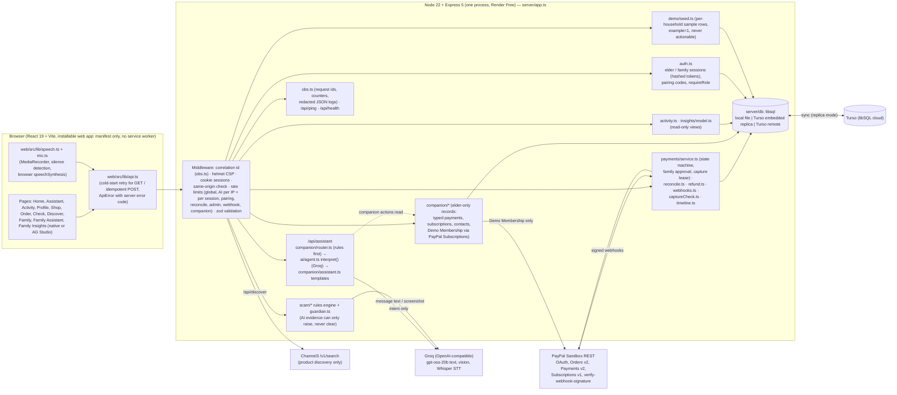

# Architecture

_Describes the code as it is on `main` after the `arch-hardening` merge (3 November 2026). Nothing here is a
proposal unless it says so. Companion documents: [PAYMENT-LIFECYCLE.md](PAYMENT-LIFECYCLE.md) (state machine and
sequences), [SECURITY-BOUNDARIES.md](SECURITY-BOUNDARIES.md) (trust boundaries, AI tool matrix),
[TEST-EVIDENCE.md](TEST-EVIDENCE.md) (what was tested, how, on which commit)._

## Principle

**AI interprets → server rules decide → the user taps → PayPal processes → the server verifies with PayPal.**
The models only ever produce an intent or text. Every effect (a payment request, a family decision, a capture, a
subscription cancel) is a separate HTTP route that re-checks the session, household, catalogue price, policy and
approval in server code.

## Components (actual code)

### Responsibilities

| Layer | Files | Responsibility |
|---|---|---|
| Frontend | `web/src` | Accessible UI, voice capture and playback, conversation thread (sessionStorage), cards that call the API. Never computes prices or decides state. |
| HTTP + middleware | `server/app.ts`, `server/obs.ts` | Routing, CSP, same-origin check, rate limits, zod parsing, correlation ids, error → `{ error, message, requestId }`. |
| Identity | `server/auth.ts` | Demo households (one per visitor), elder and family cookies (`ss_elder`, `ss_family`, httpOnly, SameSite=Lax, Secure in production), SHA-256 hashed session tokens, 6-digit one-time pairing codes (15 min). Household id always comes from the session. |
| Assistant | `server/companion/router.ts`, `server/ai/agent.ts`, `server/companion/assistant.ts`, `server/ai/outputGuard.ts` | Rules-first routing for questions about the elder's own records; otherwise one Groq call that returns a zod-validated intent. The server answers from the database with templates; free model text is guarded (no safety vouching, no claimed effects). |
| Scam check | `server/scam/*` | Deterministic rules + trusted directory + optional AI evidence that must quote the message and can only raise the verdict. |
| Payments | `server/payments/*`, `server/paypal/client.ts` | State machine, risk + policy, family approval bound to a basket fingerprint, PayPal order/capture, capture lease, reconcile (read-only), webhooks, merchant refund (admin token only), receipt timeline. |
| Companion records | `server/companion/*` | Elder-only typed payments, subscriptions, contacts; SaySafe Demo Membership (PayPal Subscriptions sandbox) cancel needs a single-use tap token. |
| Read models | `server/activity.ts`, `server/insights/*` | Activity list (elder or family view), Family Safety Insights (family only, read-only). |
| Persistence | `server/db/*` | One synchronous libsql API for local file, Turso embedded replica (hosted) or Turso remote. Schema is idempotent `CREATE TABLE IF NOT EXISTS` + additive `ADDED_COLUMNS` migrations on boot. |
| External | PayPal Sandbox, Groq, Channel3 | PayPal is the source of truth for money. Groq is untrusted. Channel3 is discovery-only (no purchase path). |

### Where responsibilities are coupled (found in the review)

| Coupling | Evidence | Status |
|---|---|---|
| Webhook intake (parse, verify, persist, dispatch) lived inline in the route | was `server/app.ts` L70–95 on `7cf3b1e` | **Fixed**: moved to `server/payments/webhooks.ts` with processing status and retry. |
| `server/app.ts` is a 550-line router with business rules inline (assistant shop branch, discover, health) | `server/app.ts` | Deferred (P2): split into route modules; no behaviour change needed for the release. |
| `confirmAndCapture` both verifies the order and owns concurrency | `server/payments/service.ts` | Kept in one place on purpose (smaller blast radius); concurrency is now an explicit lease (`claimCaptureLease`). |
| Receipt "webhook verified" is derived by querying `webhook_events` from four places | `service.ts publicView`, `activity.ts`, `companion/store.ts`, `insights/model.ts` | Deferred (P2): one helper. Behaviour is consistent today (same SQL). |
| Rate limits are in-memory (per process) | `express-rate-limit` default store, `reconcile.ts` throttles | Acceptable for one Render instance; documented limitation. |

## Data model and evidence

Tables: `users`, `sessions`, `households`, `family_links`, `spending_policies`, `payment_requests` (versioned, `example`
flag, `capture_lease_until`), `approvals`, `refund_requests`, `refunds`, `webhook_events` (+ `processed_at`, `outcome`,
`attempts`), `security_scans` (verdict + headline only, never the message), `user_preferences`,
`companion_payments`, `companion_subscriptions`, `companion_cancel_tokens`, `companion_contacts`, `demo_seeds`,
`audit_log`. Details: [DATABASE.md](DATABASE.md).

### Evidence model (every money record)

| Field | Demo Shop payment (`payment_requests`) | Typed record (`companion_payments`) | Sample row (`example=1`) |
|---|---|---|---|
| Household | `household_id` (from session) | `household_id` | `household_id` (own copy per visitor) |
| Source | `source: paypal_sandbox` | `source: user_entered` | `source: sample` |
| Real vs sample | `example=0` | `example=0` | `example=1`, badge "Sample data" |
| External ids | `paypal_order_id`, `paypal_capture_id` (UNIQUE) | none | none (refused by every action) |
| Amount / currency | `amount_cents`, `currency` (server catalogue), `captured_amount/currency` (PayPal) | as typed | catalogue price |
| Time / status | `created_at`, `updated_at`, `state` | `paid_on`, `RECORDED` | as seeded |
| Verification | `verification`: `paypal_webhook_verified` / `paypal_capture_recorded` / `paypal_order_only` / `no_paypal_record`; Payments v2 read-back in the timeline | always `user_entered_unverified` ("Recorded by you — not verified") | `illustrative` |
| Audit | `audit_log` row per transition (`payment.A->B`), approvals, refunds | none (private to the elder, not audited by design) | none |

`verification` and `externalIds` are returned on every Activity item (`server/activity.ts`). Tests:
`tests/authz-isolation-evidence.test.ts` § 3.

### Double counting rules

- **Activity**: one item per `payment_requests` row and (elder only) one per `companion_payments` row. Never merged.
- **Assistant search** (`paymentCandidates`): Demo Shop rows only where money moved (CAPTURED / REFUND_*), plus typed
  records. Candidates are de-duplicated by id before matching. A query naming a person never matches a shop purchase.
- **Insights**: Demo Shop rows only; typed records never. Totals only from `CAPTURED`. Sample totals are reported
  separately from sandbox totals (bug fixed in this review: the query did not select `example`, so sample captures
  were counted as "Sandbox captures").
- **Repeated payments** (John €80): `classifyRepeat` (`server/companion/match.ts`) separates
  *identical entries* (same day + same note: maybe typed twice), *possible duplicate* (same payee + amount within
  14 days, same work: ask before paying again) and *separate payments* (different work or far apart: mentioned
  without alarm).

## Persistence and recovery

- Hosted: Turso **embedded replica** (local libsql file synced with Turso Free). Survives Render restarts and
  redeploys (proven live 2026-11-03 01:39, see TEST-EVIDENCE §6).
- PayPal is the source of truth: `reconcile.ts` re-reads orders/captures/refunds (GET only) on page load (rate
  limited), on "Check with PayPal" and in a lazy per-household sweep. It never captures.
- Captures use a durable `PayPal-Request-Id` (`capture-<requestId>`); orders `create-<requestId>`; refunds store their
  key before the call. A retry after a timeout or a restart can never move money twice.
- Webhooks are stored before processing; a crash leaves `processed_at` NULL, the endpoint answers 500, PayPal
  redelivers, and the redelivery is processed.
- Backups: `npm run db:backup` (manual). No automated backup schedule on the free tier (limitation).

## Observability

`server/obs.ts`: `X-Request-Id` on every response (incoming id kept if it matches `[A-Za-z0-9_-]{8,64}`), the same id
in every JSON error body, structured redacted JSON logs, in-process counters. `GET /api/ping` (no I/O) for uptime
pingers. `GET /api/health`: database ping, PayPal counters (calls, timeouts, network errors, 4xx/5xx, token retries,
capture calls, unknown outcomes, lease denials), webhook status (stored, unprocessed, failed, last received) and
counters, reconcile outcomes, AI status (cached 5 min) and counters, Channel3 counters. No secrets, no PII.
Counters reset on restart (no paid metrics backend).

## Known limitations

- One process on Render Free (sleeps when idle, ~50 s cold start). In-memory rate limits and counters.
- English is the only verified language (other reply languages are beta). Voice: tap-to-interrupt verified only in
  Chromium (headless, simulated microphone); **iOS is unsupported/untested**; no physical-device tests yet.
- The installable app has a manifest but no service worker (no offline mode).
- `server/app.ts` remains a large router (P2).
- PayPal Sandbox only (`PAYPAL_API_BASE` refuses live unless `PAYPAL_ALLOW_LIVE=yes`).
