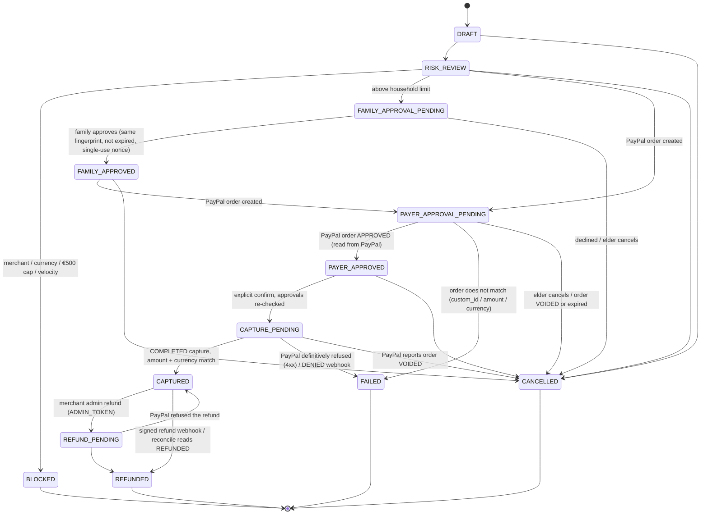
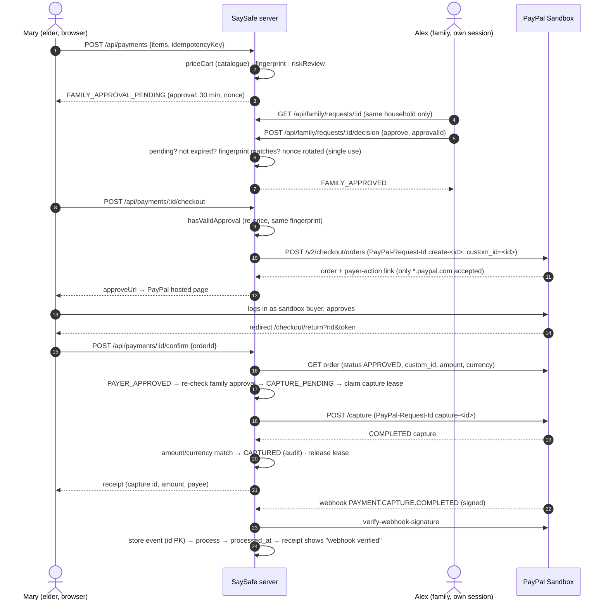
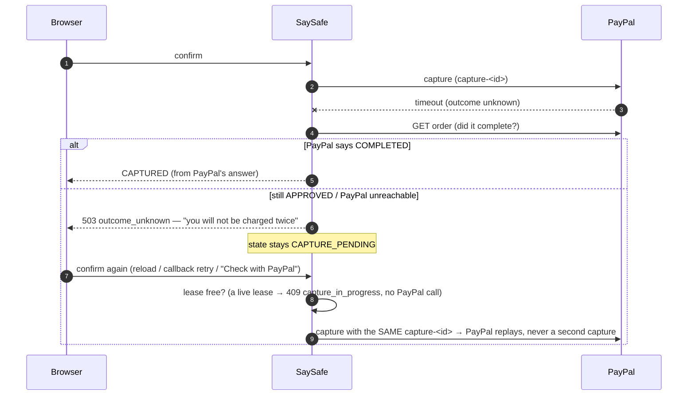

# Payment lifecycle

_Code: `server/payments/stateMachine.ts`, `service.ts`, `reconcile.ts`, `webhooks.ts`, `refund.ts`,
`server/paypal/client.ts`. Tests: `tests/payment-engine.test.ts` (transition matrix + failure injection),
`tests/webhook-intake.test.ts`, `tests/payments.test.ts`, `tests/payment-recovery.test.ts`, `tests/refund.test.ts`,
`tests/restart.test.ts`. Recovery details: [PAYMENT-RECOVERY.md](PAYMENT-RECOVERY.md)._

## State machine

22 allowed edges out of 169 ordered pairs. Every pair is tested twice: the pure `assertTransition` and the database
`transition()` (optimistic lock on `version` + `state`, one `audit_log` row per committed edge, nothing written on a
forbidden edge). Sample rows (`example=1`) are refused before the state machine is consulted.
Result on this branch: **169/169 pure + 169/169 database edges as specified** (`tests/payment-engine.test.ts`).

## Invariants (server-enforced)

1. **Amounts and currency come from the server catalogue** (`priceCart`), never from the browser or the AI.
2. **Family approval is bound to one transaction**: SHA-256 fingerprint of items, unit prices, quantities, total,
   currency and merchant; 30-minute expiry; single-use nonce; same household; re-checked (and re-priced) right before
   capture.
3. **Family approval never pays.** The payer still logs in and approves on PayPal's own page.
4. **Capture only after PayPal says APPROVED**, read from PayPal (`GET /v2/checkout/orders/:id`), with `custom_id`,
   amount and currency matching the local record.
5. **One capture call in flight per request** (`capture_lease_until`, an atomic conditional UPDATE, 45 s lease).
6. **Durable idempotency**: request key (unique, same basket only, else 409 `idempotency_key_reused`),
   `PayPal-Request-Id` `create-<id>` / `capture-<id>`, refund key stored before the call.
7. **Unknown ≠ failed**: timeout / network / 5xx keep `CAPTURE_PENDING` and answer 503 `outcome_unknown`
   ("You will not be charged twice"); only a definite 4xx records `FAILED`.
8. **Refunds are separate from family approval**: only a merchant admin with `ADMIN_TOKEN` (header `X-Admin-Token`,
   constant-time compare) can refund; without the token the route answers 503 `refunds_disabled` (the hosted demo).
   Family members have no refund route; the buyer can only *request* a refund (no money moves).
9. **Sample rows never move**: checkout, confirm, finish, cancel, decision, reconcile, refund request and webhooks
   all refuse or ignore `example=1` rows.

## Sequence: purchase above the family limit

Below the limit, steps 3–7 are skipped and the order is created immediately (`RISK_REVIEW → PAYER_APPROVAL_PENDING`).

## Sequence: failures and recovery

| Failure | Behaviour | Test |
|---|---|---|
| Order create timeout / 5xx | 503 `paypal_unavailable`, stays `RISK_REVIEW`, retry re-uses `create-<id>` (one order) | payment-engine "order create" |
| Order create 4xx | 502 `paypal_rejected`, nothing charged | same |
| Order without approval link | 502 `paypal_no_link`, no redirect | same |
| Capture timeout after PayPal captured | order re-read → `CAPTURED`, one PayPal capture | "timeout after PayPal captured" |
| Capture timeout before PayPal acted | 503 `outcome_unknown`, `CAPTURE_PENDING`; retry same id | "timeout where PayPal had not acted" |
| Capture 5xx / 4xx | unknown (stays pending) / `FAILED` | "PayPal 5xx …" |
| 200 with unknown body or PENDING capture | never `CAPTURED` | "200 with an unknown body" |
| Captured amount differs | 500 `amount_mismatch`, never `CAPTURED` | "captured amount differs" |
| 10 concurrent confirms | exactly 1 PayPal capture call | "10 concurrent confirms …" (×2) |
| Callback retry / reload / finish | 1 capture call in total | "callback retry …" |
| Restart mid-capture | lease blocks until expiry; then same id, PayPal replays | "restart mid-capture" |
| DB restart with pending capture | persisted; retry same `PayPal-Request-Id` | `restart.test.ts`, `payment-restart.test.ts` |

Mutation check: with the lease removed, the concurrent-on-`CAPTURE_PENDING` and restart tests fail (more than one
capture call), so the tests detect the regression they guard against.

## Live (real PayPal Sandbox) vs mocked

See [TEST-EVIDENCE.md](TEST-EVIDENCE.md). Everything in the failure table is **mocked** (PayPal test double that
mirrors PayPal's documented `PayPal-Request-Id` replay). The live sandbox evidence is: buyer approval on PayPal's
hosted page + capture (2 Nov), hosted capture + duplicate confirm + lost-redirect recovery + signed webhook persisted
+ restart persistence (3 Nov 01:25–01:57), sandbox refund via API.
